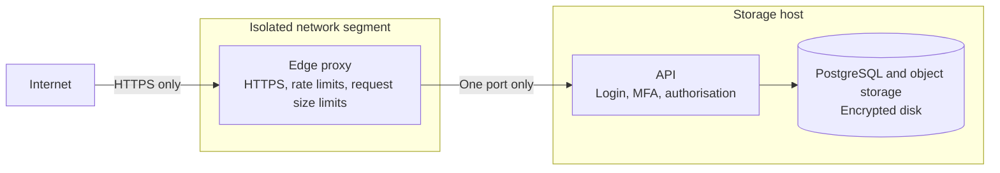

# 0006: Public access through a separate edge device

- **Status:** Proposed. Nothing here is built or tested, and it follows the first LAN-only release
- **Date:** 2026-11-04

## Problem

The owner wants to reach PocketCloud from anywhere on a subdomain, behind a login. Exposing the machine that holds the files directly to the internet would put the data one vulnerability away from attackers.

## Options

1. **Port forward straight to the storage host:** simple, but the data host faces the internet.
2. **Private network only:** the lowest risk, but no public subdomain. A mesh VPN could provide this from the owner's own devices, and may be enough on its own.
3. **Separate edge device in front of a dedicated host:** a small reverse proxy takes internet traffic and can reach only the API on the storage host.

## Decision

Option 3 is the proposed direction, using a Raspberry Pi as the edge device and a dedicated Linux machine as the host.

Uploads use the streaming gateway from [ADR 0004](0004-upload-path.md), so object storage is never exposed.

## Requirements before going public

- Network isolation: the edge device can reach only the API port, and cannot reach the rest of the home network
- A dedicated edge device that does nothing else. A device that also provides services to the home network, such as DNS, is not isolated from it
- Host-only session cookies, so other subdomains of the same domain never receive them
- Multi-factor authentication, login throttling, and established authentication libraries
- HTTPS with automatic certificate renewal
- Encrypted disk on the storage host, since it can be stolen
- Automatic security updates and a patching routine on both machines
- Alerts for repeated login failures and low disk space
- An independent backup, and a tested restore
- The threat model reviewed, and an external scan of what is actually exposed

## Consequences

- A compromised edge device does not directly expose data, but only if network isolation is real. On a flat home network it could reach everything.
- The application login still faces the internet through the proxy, so the edge device reduces exposure rather than removing it.
- The edge device limits transfer speed, and home upload speed limits downloads.
- Both machines need patching, and being reachable depends on both being on.
- Public file sharing and uploads by other people stay out of scope, and would need their own decision.
- Revisit how traffic reaches the edge (a tunnel or a forwarded port) once the connection type and the device are known.
