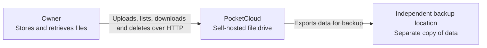
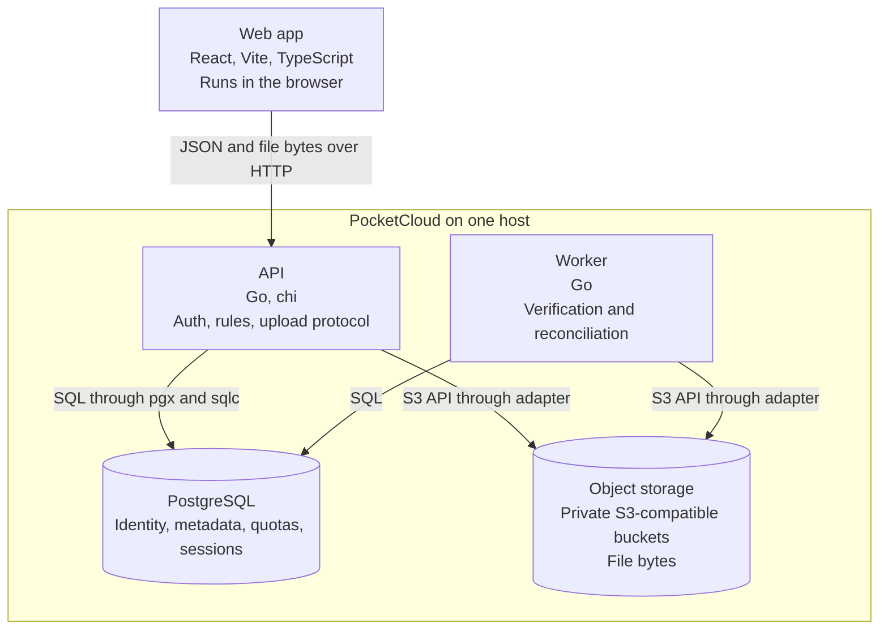
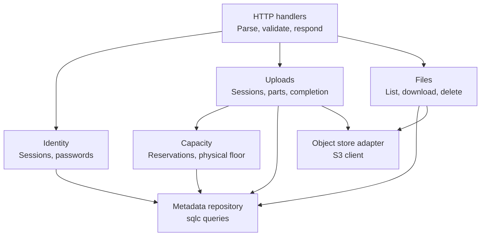
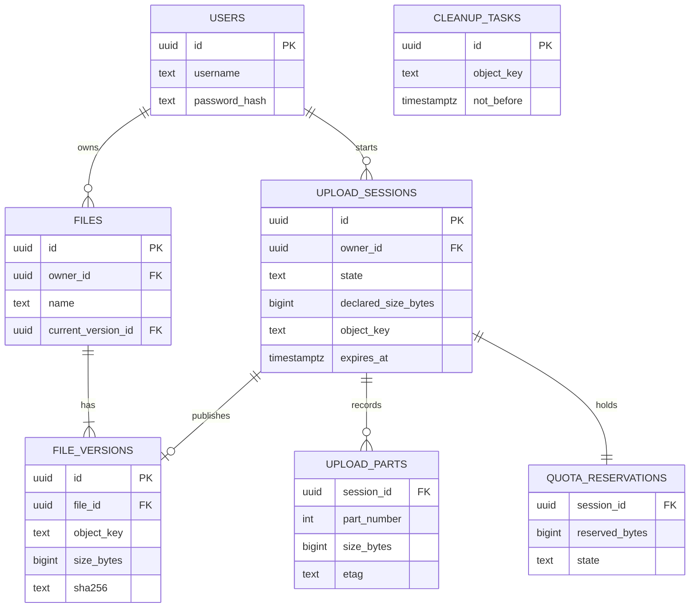
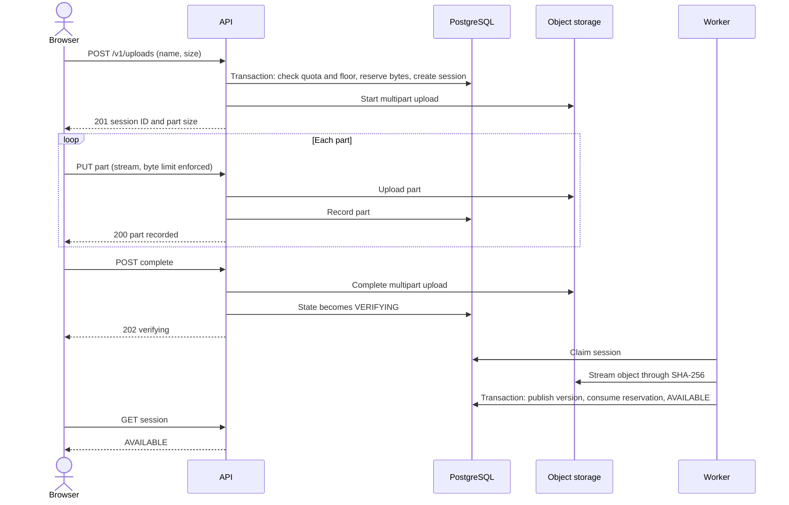
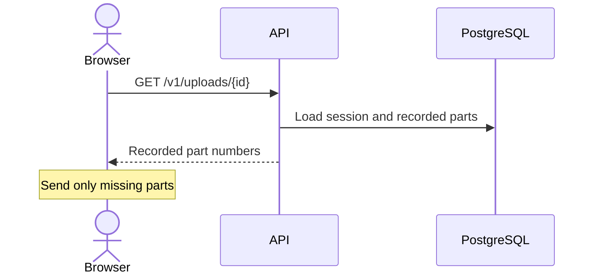
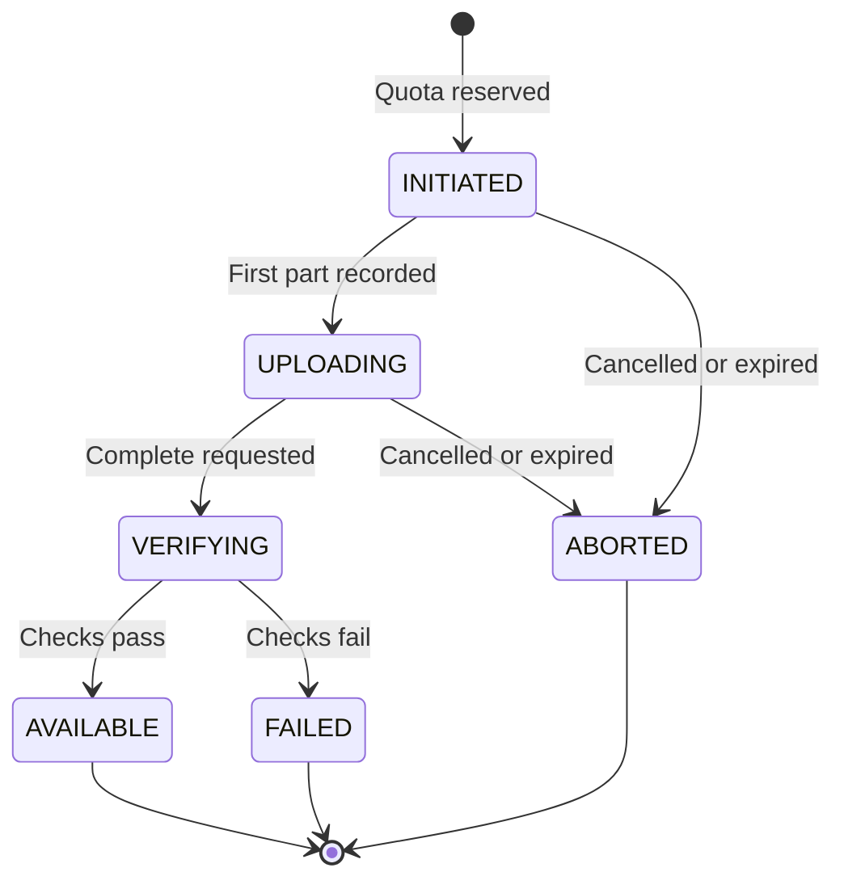
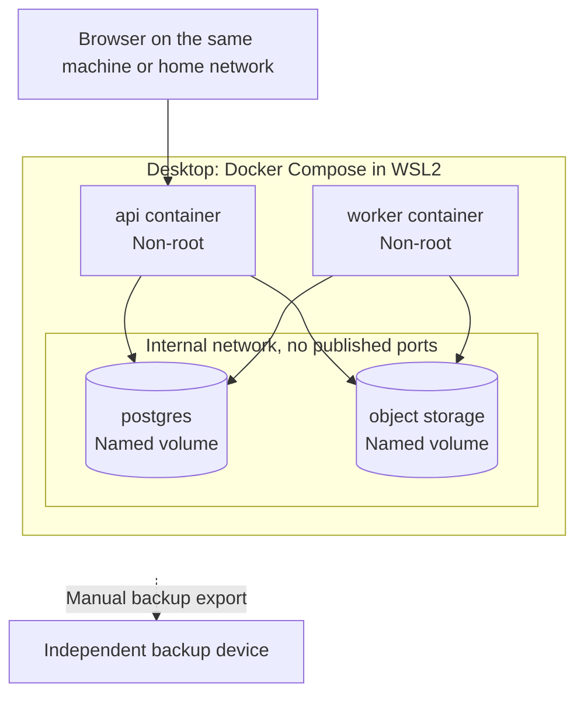

# PocketCloud architecture

**Status:** planned. Nothing here is implemented or tested yet.
**Format:** [arc42](https://arc42.org/overview) sections with [C4 model](https://c4model.com/) diagrams.

## 1. Introduction and goals

PocketCloud is a self-hosted file drive. One owner stores files on hardware they control and can
trust that what they get back is exactly what they put in.

**Quality goals, most important first:**

| Priority | Goal | Meaning here |
|---|---|---|
| 1 | Integrity | A file is only shown as available after its bytes are verified |
| 2 | Confidentiality | Files and storage are private by default |
| 3 | Recoverability | Interrupted transfers resume, and backups are proven by restoring them |
| 4 | Bounded resource use | Uploads cannot fill the disk or exhaust memory |
| 5 | Simplicity | One person can understand, run and repair it |

Availability is deliberately absent. Downtime is accepted, while data loss is not.

## 2. Constraints

| Constraint | Consequence |
|---|---|
| Runs on one existing machine | No redundancy, and capacity is whatever the disk has free |
| No paid services | Self-hosted object storage and database |
| Public source code | Security cannot rely on hiding the design |
| Learning project | Build the drive logic, and use an established engine for blob durability |

## 3. Context and scope

**C4 level 1: who and what the system talks to.**

**Out of scope for the first release:** public internet access, sharing, folders, multiple users,
trash and version retention. PocketCloud does not replace an independent backup.

## 4. Solution strategy

| Problem | Approach | Decision |
|---|---|---|
| Keep it understandable | One deployable API and one worker, organised by capability | [ADR 0001](adr/0001-modular-monolith.md) |
| Files and metadata need different storage | PostgreSQL for metadata, object storage for bytes, behind an adapter | [ADR 0002](adr/0002-separate-metadata-and-objects.md) |
| Choose a storage engine safely | SeaweedFS as a candidate until it passes its gates | [ADR 0003](adr/0003-seaweedfs-candidate.md) |
| Bound uploads during transfer | Choose signed URLs or a streaming gateway from test evidence | [ADR 0004](adr/0004-upload-path.md) |
| No transaction spans both stores | Explicit states, idempotent steps and a reconciler | [ADR 0005](adr/0005-state-machine-and-reconciliation.md) |

## 5. Building block view

**C4 level 2: the separately running parts.**

**Why two stores:** PostgreSQL is excellent at transactions and rules but poor at holding many
gigabytes of file bytes. Object storage is the reverse. The price of using both is section 8.3.

**C4 level 3: inside the API.** Dependencies point inward, so business rules do not import HTTP or S3 code.

**Data model for the first release.** Objects use random keys, so a filename never becomes a storage path.

Folders, share tokens and retained versions arrive with later scope, after physical-space accounting is proven.

## 6. Runtime view

### 6.1 Upload

Shown with the streaming gateway. If signed URLs pass their gates, the browser sends parts directly
to storage and the rest stays the same ([ADR 0004](adr/0004-upload-path.md)).

### 6.2 Resuming after an interruption

The browser asks which parts are recorded and sends only the rest. After a refresh it cannot silently
reopen a local file, so the owner reselects it and the app checks size and checksums before continuing.

### 6.3 Upload states

Each transition is a conditional update from an expected state, so repeating a request or job is harmless.

### 6.4 What happens when something crashes

This table is the heart of the design. PostgreSQL and object storage cannot commit together, so every gap needs an answer.

| Crash point | State left behind | Recovery |
|---|---|---|
| After reservation, before multipart start | Session with no upload | Session expires and the reservation is released |
| During part upload | Part unrecorded, but bytes already sent stay on disk | Browser resends. Vacuum reclaims the partial bytes later |
| After part stored, before it is recorded | Stored bytes unknown to PostgreSQL | Browser resends. The API records the newest tag for each part. Later cleanup reclaims the extra bytes |
| After storage completes, before VERIFYING is saved | Object complete, session UPLOADING | Reconciler checks storage and continues, or the client retries safely |
| During verification | Session stays VERIFYING | Claim expires and another worker verifies again |
| After publication commits | File AVAILABLE | Nothing needed |
| Session abandoned | Parts consuming disk | Expiry aborts the multipart upload and releases the reservation. Vacuum alone does not free these bytes |

## 7. Deployment view

Docker Compose on one desktop, inside WSL2. Only the API is reachable from the browser. Signed URLs
would also expose the storage endpoint, which is one of the tradeoffs in [ADR 0004](adr/0004-upload-path.md).

Stopping containers is routine. Deleting a volume or WSL distribution destroys data unless it is
backed up, so volume removal is never part of a normal stop command.

## 8. Cross-cutting concepts

### 8.1 Authentication and authorisation

Use established session and password-hashing libraries, with secure HttpOnly cookies and CSRF protection on
mutations. Check ownership in the application operation for every file and session, never only in the UI.

### 8.2 Capacity accounting

Two separate limits apply, because logical size does not equal disk use:

| Budget | Counts | Purpose |
|---|---|---|
| Logical quota | Live file bytes plus active reservations | The promise to the owner, starting at 10 GiB |
| Physical floor | Measured free disk space | Refuses new transfers before the host runs out |

The physical budget must also cover unfinished parts, rejected uploads awaiting cleanup, storage-engine
overhead, deleted bytes not yet vacuumed, partial transfers, retried parts and maintenance space. In a
[64 MiB trial](benchmarks/2026-11-04-seaweedfs-resume-trial.md), one cut transfer and one retry added about 19% until cleaned up. Nothing is deleted automatically to stay under a limit.

### 8.3 Consistency

PostgreSQL decides what exists. Object storage holds bytes. Objects are written first and published in
PostgreSQL last, so a crash can leave an unreferenced object but never a file record with missing bytes.
Cleanup waits for a grace period and rechecks references before deleting.

PostgreSQL also records each part's newest tag, because the object store's own part listing can show a retried
part twice. Completion names exactly those parts. Storage returns 404 for a repeated completion, so the API
checks its own state first, which is what makes completion safe to repeat.

### 8.4 Integrity

A multipart ETag is not a whole-file MD5, so the worker streams each object through SHA-256. That proves
what is stored, not that it matches the source, so verification also compares a source hash obtained
independently, and tests the bytes that come back out.

### 8.5 Errors and observability

API errors use RFC 9457 problem details. Structured logs carry request and session IDs, and never contain
credentials. Track bytes as well as request counts: unfinished multipart bytes, reservations, free disk,
metadata and object mismatches, and verification duration.

### 8.6 Backup and restore

A complete backup needs four things, because the system cannot be rebuilt without all of them:

| Item | Why |
|---|---|
| PostgreSQL | Knows which files exist, who owns them and their expected hashes |
| Object storage volume | Holds the bytes and the storage engine's own metadata |
| Storage and application configuration | Includes credentials, which are not inside the volume |
| Source manifest, kept separately | Proves that restored files match the originals |

Stop writes first, so PostgreSQL and storage describe the same moment. A [restore trial](benchmarks/2026-11-04-seaweedfs-restore-trial.md)
proved the object storage part with the original destroyed. PostgreSQL is not yet included, and a copy on the same disk does not survive that disk failing.

## 9. Architecture decisions

See the [decision records](adr/). Section 4 maps each one to the problem it solves.

## 10. Quality requirements

| Scenario | Expected response |
|---|---|
| Connection drops at 90% of a large upload | Resume sends only missing parts, and the final hash matches |
| API restarts during an upload | No published data changes, and the session can continue |
| Upload sends more bytes than declared | Stopped during transfer, before the host disk fills |
| Two uploads compete for the last quota | One is refused, and the total never exceeds quota |
| Stored object is corrupted before verification | File is never published |
| A second user requests the owner's object ID | Refused, with no indication of existence |
| Metadata and objects are restored elsewhere | Selected files come back with matching checksums |

Acceptance tests are in the [requirements](requirements.md).

## 11. Risks and technical debt

| Risk | Impact | Response |
|---|---|---|
| Storage engine overhead exceeds the disk budget | Project cannot hold planned data | Measure early, and swap the engine behind the adapter |
| Single disk holds every copy | Disk failure loses everything | Do not trust PocketCloud with sole copies, and add independent storage |
| Oversized direct uploads | Disk exhaustion | Prove limits, or use the gateway |
| Browser hashing of very large files | No built-in streaming SHA-256 in Web Crypto | Open question: use an incremental hash library or an independent manifest |
| Gateway adds API load | Lower throughput | Acceptable for one user, and measure it |
| New language for the owner | Slower progress and subtle concurrency bugs | Race detector, small modules, reading before merging |

## 12. Glossary

| Term | Meaning |
|---|---|
| Object storage | Stores whole blobs by key instead of a folder hierarchy of editable files |
| Multipart upload | Sending one object as numbered parts, then asking storage to assemble them |
| Signed URL | A temporary link that grants one storage operation. Anyone holding it can use it |
| Streaming gateway | The API passes bytes through to storage without holding the whole file |
| Idempotent | Repeating an operation gives the same result as doing it once |
| Reconciler | A background process that compares recorded and actual state, then repairs the difference |
| Modular monolith | One deployable program with strict internal module boundaries |

## Appendix: test your understanding

You should be able to answer these without looking, and defend them in an interview:

1. Why not store files inside PostgreSQL?
2. Why publish in PostgreSQL last, and what goes wrong if the order is reversed?
3. Why is a final size check not enough to protect the disk?
4. Why does quota need a reservation inside a transaction rather than a check before writing?
5. What does a checksum of stored bytes prove, and what does it not prove?
6. Why is two copies on one disk not a backup against disk failure?
