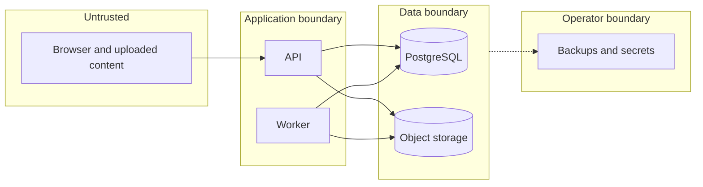

# Threat model

**Status:** initial draft against the planned design. No control here is implemented yet.
**Method:** data flows and trust boundaries, then [STRIDE](https://learn.microsoft.com/en-us/azure/security/develop/threat-modeling-tool-threats) per element.

**Valuable assets:** user files, file metadata, sessions, storage credentials, backups.

## Trust boundaries

## Threats

| STRIDE | Threat | Planned mitigation | Verified by |
|---|---|---|---|
| Spoofing | Password guessing or stolen sessions | Established auth libraries, login throttling, secure HttpOnly cookies | Auth tests |
| Spoofing | Open object store through default settings | Credentials and denying policies, internal network only | Unauthenticated reads and writes fail |
| Tampering | Corrupted or substituted object | SHA-256 before publication, and failed checks never publish | Corruption test |
| Tampering | Cross-site request changes files | CSRF protection on cookie-authenticated mutations | CSRF test |
| Tampering | Path traversal through filenames | Random object keys, and filenames never used as paths | Unsafe filename test |
| Repudiation | Unknown cause of a deletion | Structured logs with user and request IDs | Log review |
| Information disclosure | Cross-user access by ID | Ownership checks on every operation | Two synthetic users |
| Information disclosure | Uploaded HTML or SVG runs on the app origin | Download as attachments, safe preview formats only, isolated origin | Header test |
| Information disclosure | Secrets or file names in logs and repository | Redaction, secret scanning, synthetic fixtures | Scanner plus review |
| Denial of service | Oversized or concurrent uploads fill the disk | Enforcement during transfer, reservations, concurrency limits, physical floor | Oversize test |
| Denial of service | Abandoned sessions hold space | Expiry, multipart abort, reservation release | Cleanup test |
| Elevation of privilege | Broad storage or database credentials | Scoped credentials, and a separate migration role | Permission test |
| Elevation of privilege | Container reaches the host | Non-root containers, and no Docker socket mount | Image and Compose review |

Share tokens and signed URLs are bearer credentials. If they are added, store token hashes, keep expiry short,
never log them in full, and state in the interface that issued URLs stay valid until expiry.

## If exposed to the internet

Planned in [ADR 0006](adr/0006-public-access-through-edge-proxy.md), and required before any public exposure.

| STRIDE | Threat | Planned mitigation | Verified by |
|---|---|---|---|
| Spoofing | Automated password attacks on the public login | Multi-factor authentication, throttling, alerts | Login abuse test |
| Elevation of privilege | Compromised edge device reaches the home network | Isolated network segment, one permitted port | Connection tests from the edge device |
| Denial of service | Floods or endless uploads through the proxy | Rate limits, request size limits, disk floor | Load and oversize tests |
| Information disclosure | Stolen storage host | Encrypted disk, with keys held separately | Boot and recovery test |
| Tampering | Unpatched exposed software | Automatic updates, patching routine, dependency scans | Version review |

## Accepted risks

- A single host and disk mean no protection from hardware failure without independent backup.
- Encryption at rest is not implied by the S3 API, and is not yet designed.
